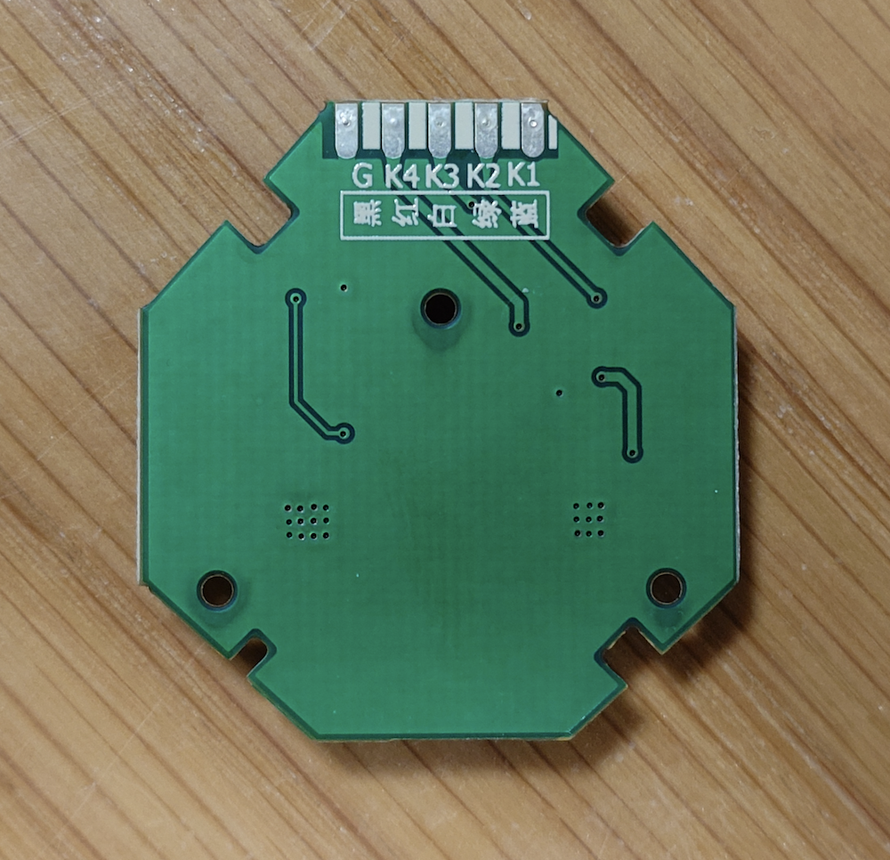
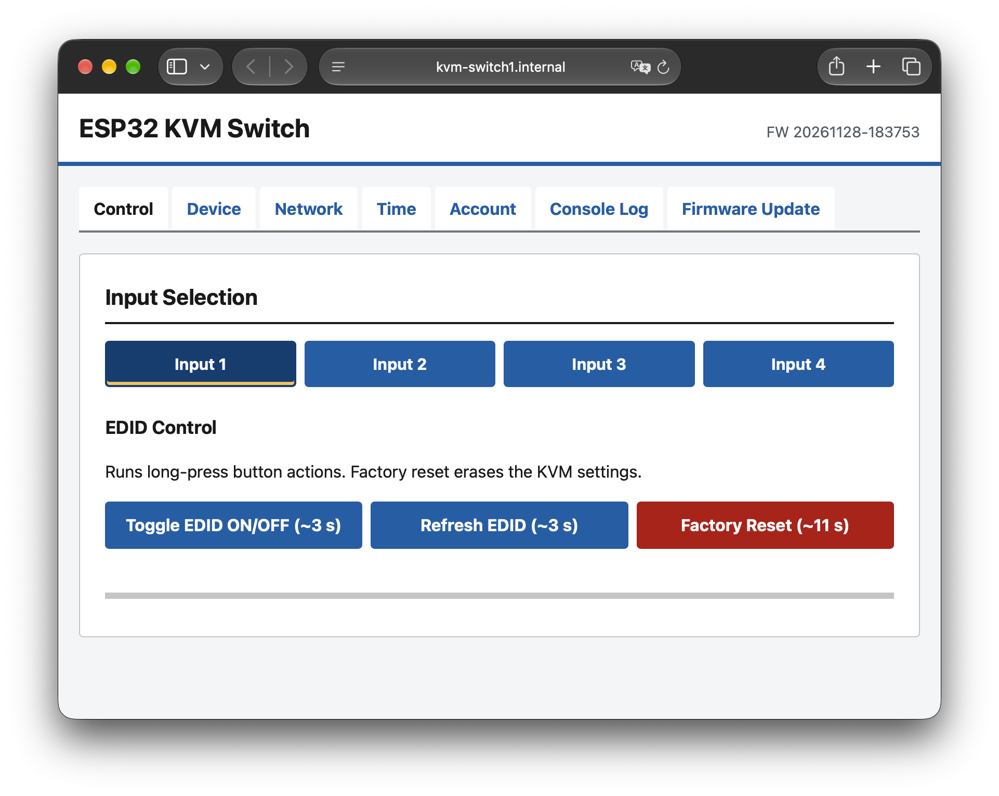
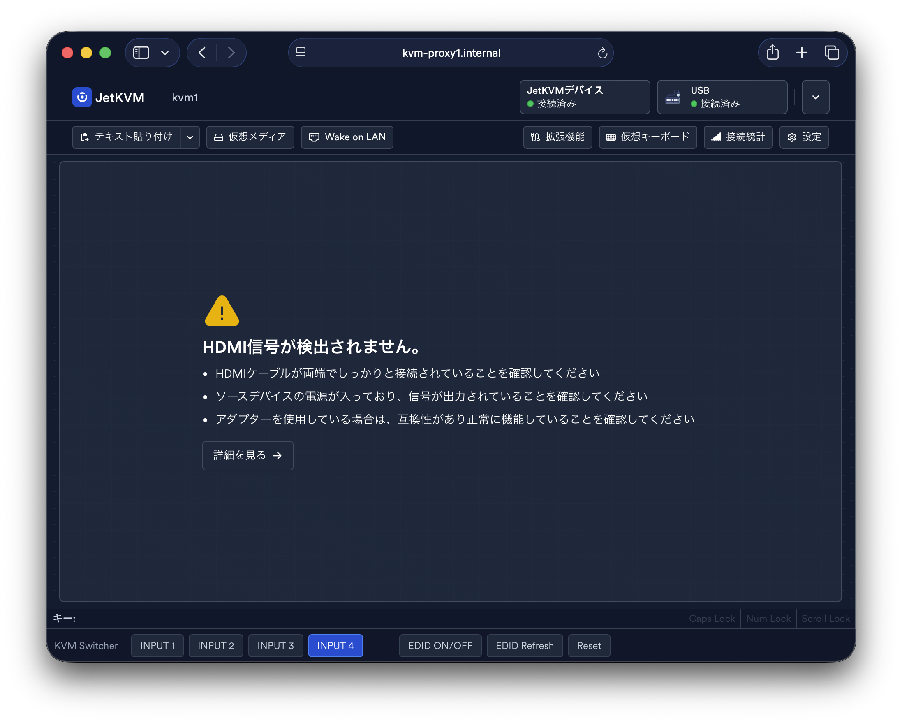

# ESP32 IP-KVM Switch

## 概要

LAN 経由で切り替え可能な KVM スイッチが高すぎて手が出せないので、ESP32 で KVM スイッチを改造して IP-KVM 化してみるプロジェクト

## 準備 (必要なもの)

はんだごて・はんだなどの工具も適当に用意する。

| 構成品                 | 製品例                                                                                                               | 価格        | 備考                                                                                                                                                   |
| ------------------- | ----------------------------------------------------------------------------------------------------------------- | :-------- | ---------------------------------------------------------------------------------------------------------------------------------------------------- |
| ESP32               | Speed Studio XIAO ESP32C6 ([秋月電子](https://akizukidenshi.com/catalog/g/g129481/))                                  | 1,000円くらい | ESP32C3 や ESP32S3 でも作れるはず。他の ESP32 デバイスでも作れるはず (別途コードを作成すれば、GPIO を持つ Raspberry Pi Pico 2 W などでも実現可能な認識) だが、Wi-Fi 搭載モデルを選ぶこと。日本で使用する場合は技適マークのあるものを購入。 |
| KVM スイッチ            | KCEVE KVM8401BA ([Amazon.co.jp](https://amzn.to/4vCGTyV))                                                         | 数千〜数万円    | KVM スイッチを 0 から作るのは大変なので、HDMI・4入力・1出力・コントローラ付きの KVM スイッチを使用。他社製の KVM でもリモコンがただのスイッチであれば、同様の仕組みで実装可能。2入力のモデルとかでも動作するはず。EDID エミュレーション機能ありのもの推奨。         |
| リレーモジュール            | DC5V駆動4チャンネルフォトリレーモジュール ([Amazon.co.jp](https://amzn.to/4cCMsF5))                                                 | 数百円       | チャンネル数は KVM スイッチの入力切り替え数に応じて。正直なんでもOK。                                                                                                               |
| USB ケーブル            | USB-C to USB-A ([Amazon.co.jp](https://amzn.to/4teYpb3))、USB-C to USB-C ([Amazon.co.jp](https://amzn.to/41GcQZK)) | 数百円       | ESP32にはケーブルは付属していないので、開発する PC に合わせて、USB-C to USB-A、USB-C to USB-C などのケーブルを用意。手持ちがあればそれでも OK。データ通信もできるケーブルが必要。50cm もあれば十分。                            |
| ケース                 | ダイソー プチプラケースL ([daisonet.com](https://jp.daisonet.com/products/4906137336318))                                    | 数百円       | ESP32・リレーモジュールなどが収まるサイズのケースを用意。当然ケースなしでも動くが、ケースがあった方が実用的。                                                                                            |
| 2.54mm ピッチのピンヘッダ    | ストレートピンヘッダー ([Amazon.co.jp](https://amzn.to/48VnNdD))                                                             | 数百円       | ESP32 を基板から取り外しできるようにしたいなら必要。                                                                                                                        |
| 絶縁電線                | 協和ハーモネット UL1429AWG28 ([Amazon.co.jp](https://amzn.to/3ONNwxS))                                                    | 数百円       | 電子回路の作り方次第で用意。                                                                                                                                       |
| スズメッキ線              | エルパ(ELPA) スズメッキ線 ジャンパー線 配線 φ0.6mm 5m HK-SM06H ([Amazon.co.jp](https://amzn.to/4vtkfJk))                           | 数百円       | 電子回路の作り方次第で用意。                                                                                                                                       |
| 2.54mm ピッチのユニバーサル基板 | ユニバーサル基板 ([Amazon.co.jp](https://amzn.to/3OBHSyG))                                                                | 数百円       | 電子回路の作り方次第で用意。                                                                                                                                       |

## IP-KVM の作成

### 回路作成

用意した構成品を繋ぐ。

USB ケーブルはKVMスイッチ付属のコントローラを分解し、基盤を取り外したケーブルを使用する。

USB ケーブルの色は KVM コントローラ KCEVE KC-SHM4 (基板シルク KC-SHM1-V3.0) に準拠。

| 表面                                                         | 裏面                                                       |
| ---------------------------------------------------------- | -------------------------------------------------------- |
|  |  |

ESP32 でリレーのコントロール、リレー (スイッチ) の COM はケーブルの G (GND) に接続し、NO (Normally Open) とリモコンの各ボタンに対応するケーブルを接続する。

また、リレーは HIGH 側で駆動するように設定する。

```
+---------------+    +---------------+
|    [ESP32]    |    |  [4ch Relay]  |    [Controller USB Cable]
|               |    |               |
|             5V|----|DC+     Ch1  NO|---- K1 (Yellow)
|            GND|----|DC-     Ch1 COM|------------------+
|               |    |        Ch2  NO|---- K2 (Green)   |
|             D0|----|IN1     Ch2 COM|------------------+
|             D1|----|IN2     Ch3  NO|---- K3 (White)   |
|             D2|----|IN3     Ch3 COM|------------------+
|             D3|----|IN4     Ch4  NO|---- K4 (Red)     |
|               |    |        Ch4 COM|------------------+---- G (Black)
+---------------+    +---------------+ 
```

完成イメージはこんな感じ。 (はんだづけのクオリティは見なかったことにしてください……)

| 表面                                                       | 裏面                                                             |
| -------------------------------------------------------- | -------------------------------------------------------------- |
|  |  |

### Arduino IDE のセットアップ

作業 PC に Arduino IDE をインストール、Speed Studio XIAO ESP32 が使えるようにセットアップ。

参考：[Seeed Studio XIAO ESP32C6 のはじめに | Speed Studio Wiki](https://wiki.seeedstudio.com/ja/xiao_esp32c6_getting_started/#ソフトウェアの準備)

### arduino-littlefs-upload のセットアップ

[arduino-littlefs-upload](https://github.com/earlephilhower/arduino-littlefs-upload) の README に従って、Arduino IDE で使えるようにセットアップする。

### 設定ファイルの作成と ESP32 への転送

[data.sample](data.sample) フォルダを `data` にリネーム。

さらに、フォルダ内の [config.json](data.sample/config.json) の内容を自身の環境に合わせて編集。

| 設定項目            | 設定内容                             | 設定値の例                  |
| --------------- | -------------------------------- | :--------------------- |
| `hostname`      | ホスト名                             | kvm1                   |
| `mdns_domain`   | mDNS ドメイン名                       | local                  |
| `wifi_ssid`     | ESP32 を接続する Wi-Fi アクセスポイントの SSID | (普段使っている Wi-Fi の SSID) |
| `wifi_password` | ESP32 を接続する Wi-Fi アクセスポイントの暗号化キー | (SSIDに対応する暗号化キー)       |
| `auth_user`     | 管理画面の BASIC 認証のユーザ名              | admin                  |
| `auth_password` | 管理画面の BASIC 認証のパスワード             | (ランダム文字列)              |

[arduino-littlefs-upload](https://github.com/earlephilhower/arduino-littlefs-upload) の README にある [Usage, uploading a filesystem to the device](https://github.com/earlephilhower/arduino-littlefs-upload#usage-uploading-a-filesystem-to-the-device) に従い、ESP32 に設定ファイルを転送する。

### ESP32 へのコード書き込み

[esp32-ip-kvm-switcher.ino](esp32-ip-kvm-switcher.ino) を Arduino IDE で開いて、ESP32 に書き込む (アップロードする)。

### 起動確認

Arduino IDE の Serial Monitor で、動作を確認。

`Webサーバー起動` と出れば OK。

```
コンフィグが読み込まれました
HOSTNAME: <hostname>
MDNS_DOMAIN: <mdns_domain>
WIFI_SSID: <wifi_ssid>
Wi-Fi (<wifi_ssid>) 接続中....
アクセスページ: http://xxx.xxx.xxx.xxx/
mDNS起動: http://<hostname>.<MDNS_DOMAIN>/
Webサーバー起動
```

### 管理画面へのアクセス

コンソールで表示された `アクセスページ` のアドレスにWebブラウザでアクセス。

BASIC 認証が求められるので、config.json で設定した `auth_user` と `auth_password` で認証。

正常に認証できれば、以下の管理画面が表示される。



入力の切り替えなど各種機能が正常に動けばOK。

## (Option) JetKVM 等の Web管理画面との統合

JetKVM など、Web ブラウザ管理の KVM と組み合わせて使用する場合、KVM スイッチボタンが統合されている方が使いやすいと思われるので、NGINX のリバースプロキシ機能を使って、KVM スイッチ切り替え機能 (ウィンドウ最下部) を注入する。



### NGINX のセットアップ

NGINX をインストールし、デフォルトページを消す。

```
apt install nginx
rm /etc/nginx/sites-enabled/default
```

### サーバ証明書の配置

`/etc/nginx/ssl` ディレクトリを作成し、サーバ証明書 (秘密鍵 `server.key` と公開鍵 `server.pem`) を配置する。

```
mkdir /etc/nginx/ssl

# オレオレ証明書を発行する場合
openssl req -x509 -nodes -days 365 -newkey rsa:2048 -keyout server.key -out server.crt
```

### 注入する JavaScript の配置

[kvm-inject.js](/nginx/static/kvm-inject.js) を `/etc/nginx/static/kvm-inject.js` に配置する。

### NGINX のプロキシ設定

[kvm-proxy](/nginx/sites-available/kvm-proxy) を `/etc/nginx/sites-available/kvm-proxy` に配置する。

配置後、環境に合わせて設定を行う。

```
    location /esp32/ {
        proxy_pass http://kvm-switch1.local/;  # ESP32 にアクセスするための IP アドレス or FQDN を設定
        :
        proxy_set_header Host kvm-switch1.local;  # ESP32 にアクセスするための IP アドレス or FQDN を設定
        proxy_set_header Authorization "Basic dXNlcjpwYXNz==";  # ESP32 認証情報をコロンで連結し、 "${auth_user}:${auth_password}" base64 コマンドでエンコードした文字列を指定
        :
    }

    location / {
        proxy_pass https://kvm1.local;  # JetKVM にアクセスするための IP アドレス or FQDN を設定
        :
```

プロキシ設定を有効化する。

```
ln -s /etc/nginx/sites-available/kvm-proxy /etc/nginx/sites-enabled/kvm-proxy
systemctl restart nginx
```

### 動作確認

KVM プロキシに HTTPS アクセスを行い、想定通り KVM スイッチボタンがページ下部に表示され、動作することを確認する。
