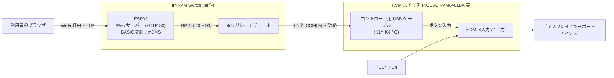
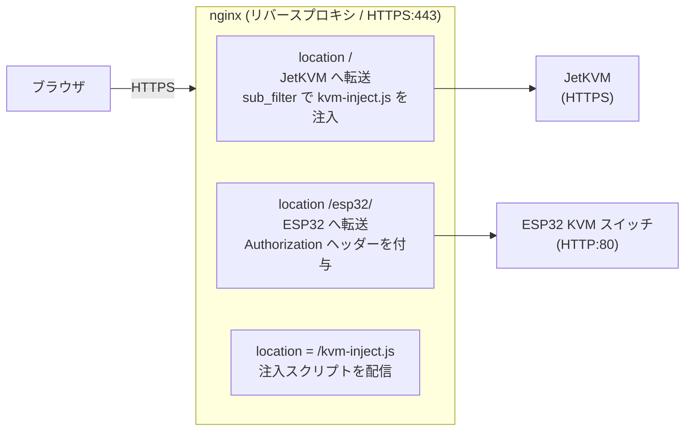
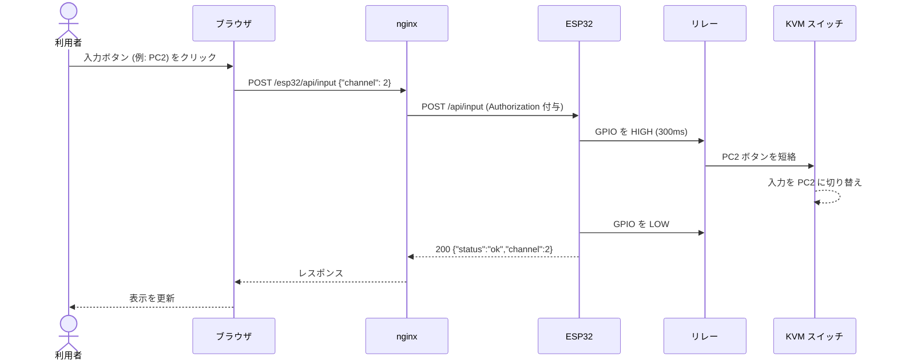
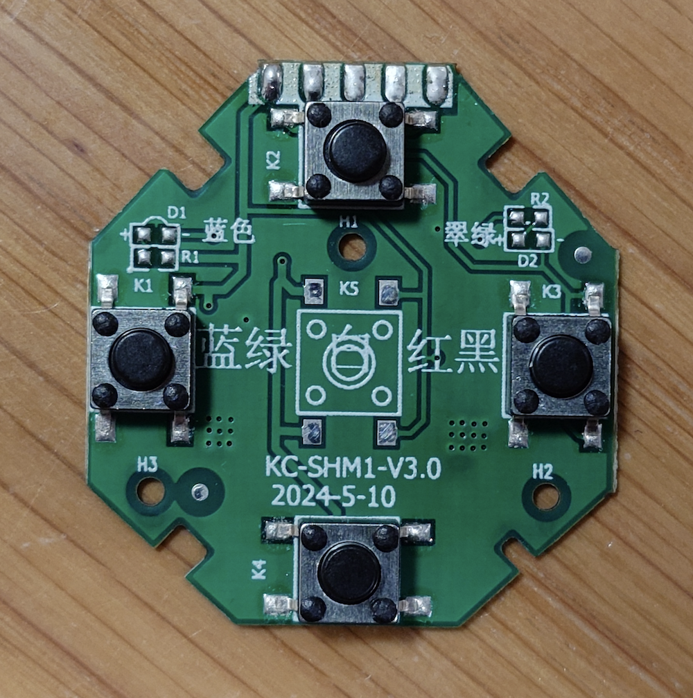
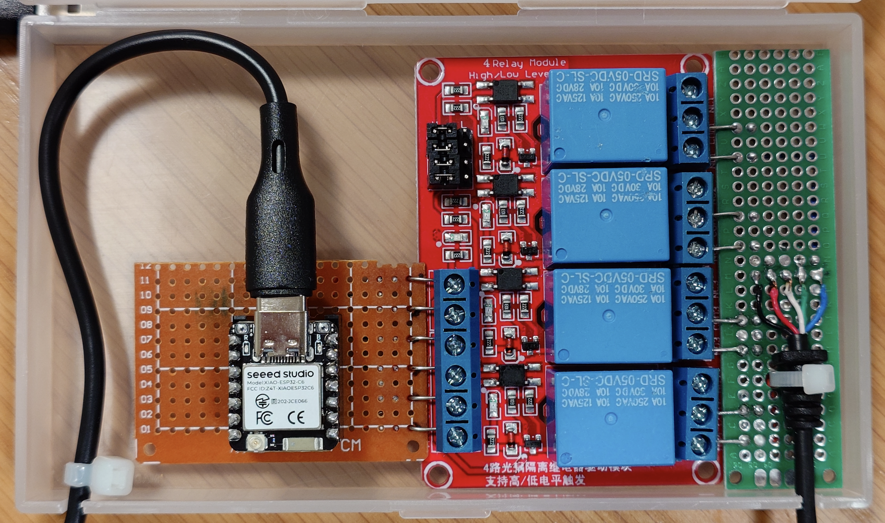
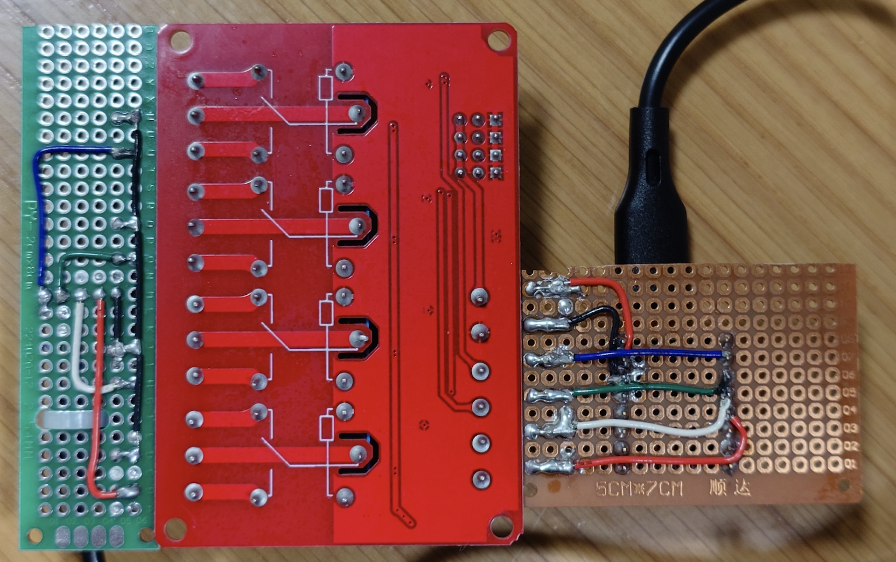

# ESP32 IP-KVM Switch

LAN 経由で切り替え可能な KVM スイッチは高価なため、市販の KVM スイッチのリモコン部分を ESP32 で置き換えて IP-KVM 化するプロジェクトです。

- ESP32 がリレーを介して KVM スイッチのコントローラボタンを「押す」ことで、入力を切り替えます。
- ブラウザの管理画面 (BASIC 認証付き) から、入力切り替え・EDID 操作・ファームウェア更新ができます。
- 管理画面から Wi-Fi・IP アドレス/DNS・NTP・管理画面アカウントを設定できます。初回は SoftAP (設定用アクセスポイント) に接続して設定するため、設定ファイルを事前に用意しなくても使い始められます。
- Console Log の各行には、NTP で同期した現地時刻が付きます。
- 管理画面に入れなくなった場合は、BOOT ボタンの長押しで設定を初期化できます。
- (オプション) JetKVM などの Web 管理画面に、切り替えボタンを nginx で注入して統合できます。

## 目次

- [構成](#構成)
- [準備 (必要なもの)](#準備-必要なもの)
- [IP-KVM の作成](#ip-kvm-の作成)
  - [1. 回路作成](#1-回路作成)
  - [2. 開発環境のセットアップ](#2-開発環境のセットアップ)
  - [3. 設定ファイルの作成と転送](#3-設定ファイルの作成と転送)
  - [4. ファームウェアの書き込み](#4-ファームウェアの書き込み)
  - [5. 起動確認](#5-起動確認)
  - [6. 管理画面へのアクセス](#6-管理画面へのアクセス)
- [管理画面の設定機能](#管理画面の設定機能)
  - [Network (Wi-Fi・IP アドレス・DNS)](#network-wi-fiip-アドレスdns)
  - [Time (NTP・タイムゾーン)](#time-ntpタイムゾーン)
  - [Account (管理画面アカウント)](#account-管理画面アカウント)
  - [Console Log](#console-log)
- [設定の初期化 (BOOT ボタン)](#設定の初期化-boot-ボタン)
- [API](#api)
- [(オプション) JetKVM 等の Web 管理画面との統合](#オプション-jetkvm-等の-web-管理画面との統合)

## 構成

### 全体構成

ESP32 は KVM スイッチ本体には直接つながず、コントローラの USB ケーブルのボタン線をリレーで短絡 (GND に接続) することで、物理ボタン操作を再現します。



### JetKVM 統合時の構成 (オプション)

nginx がリバースプロキシとして JetKVM の画面に切り替えボタン用 JavaScript を注入し、`/esp32/` へのリクエストを ESP32 に転送します。



### 入力切り替えの流れ



> nginx を使わない場合は、ブラウザが ESP32 の管理画面 (`http://<hostname>.<mdns_domain>/`) に直接アクセスします。

### ファイル構成

| パス                                                | 内容                                           |
| ------------------------------------------------- | -------------------------------------------- |
| `esp32-ip-kvm-switcher/esp32-ip-kvm-switcher.cpp` | ファームウェア本体 (Web サーバー・リレー制御・Wi-Fi/SoftAP/mDNS/NTP 管理・OTA) |
| `esp32-ip-kvm-switcher/data.sample/config.json`   | 設定ファイルのサンプル (`data` にリネームして使用)               |
| `platformio.ini`                                  | PlatformIO のビルド設定 (Seeed XIAO ESP32C6)       |
| `partitions.csv`                                  | パーティション定義 (OTA 用に app0 / app1 の 2 面構成)       |
| `scripts/`                                        | ビルド番号の埋め込み、mklittlefs の指定                    |
| `nginx/sites-available/kvm-proxy`                 | JetKVM 統合用の nginx 設定                         |
| `nginx/static/kvm-inject.js`                      | 切り替えボタンを注入する JavaScript                      |
| `readme-img/`                                     | README 用の画像                                  |

## 準備 (必要なもの)

はんだごて・はんだなどの工具も適当に用意してください。

| 構成品                 | 製品例                                                                                                               | 価格        | 備考                                                                                                                                                   |
| ------------------- | ----------------------------------------------------------------------------------------------------------------- | :-------- | ---------------------------------------------------------------------------------------------------------------------------------------------------- |
| ESP32               | Seeed Studio XIAO ESP32C6 ([秋月電子](https://akizukidenshi.com/catalog/g/g129481/))                                  | 1,000円くらい | ESP32C3 や ESP32S3 でも作れるはず (ESP32S3 は BOOT ボタンとリレー用ピンの衝突に注意。[配線](#配線)参照)。他の ESP32 デバイスでも作れるはず (別途コードを作成すれば、GPIO を持つ Raspberry Pi Pico 2 W などでも実現可能な認識) だが、Wi-Fi 搭載モデルを選ぶこと。日本で使用する場合は技適マークのあるものを購入。 |
| KVM スイッチ            | KCEVE KVM8401BA ([Amazon.co.jp](https://amzn.to/4vCGTyV))                                                         | 数千〜数万円    | KVM スイッチを 0 から作るのは大変なので、HDMI・4入力・1出力・コントローラ付きの KVM スイッチを使用。他社製の KVM でもリモコンがただのスイッチであれば、同様の仕組みで実装可能。2入力のモデルとかでも動作するはず。EDID エミュレーション機能ありのもの推奨。         |
| リレーモジュール            | DC5V駆動4チャンネルフォトリレーモジュール ([Amazon.co.jp](https://amzn.to/4cCMsF5))                                                 | 数百円       | チャンネル数は KVM スイッチの入力切り替え数に応じて。正直なんでもOK。                                                                                                               |
| USB ケーブル            | USB-C to USB-A ([Amazon.co.jp](https://amzn.to/4teYpb3))、USB-C to USB-C ([Amazon.co.jp](https://amzn.to/41GcQZK)) | 数百円       | ESP32 にはケーブルが付属していないので、開発する PC に合わせて USB-C to USB-A、USB-C to USB-C などを用意。手持ちがあれば OK。データ通信もできるケーブルが必要。50cm もあれば十分。                            |
| ケース                 | ダイソー プチプラケースL ([daisonet.com](https://jp.daisonet.com/products/4906137336318))                                    | 数百円       | ESP32・リレーモジュールなどが収まるサイズのケースを用意。当然ケースなしでも動くが、ケースがあった方が実用的。                                                                                            |
| 2.54mm ピッチのピンヘッダ    | ストレートピンヘッダー ([Amazon.co.jp](https://amzn.to/48VnNdD))                                                             | 数百円       | ESP32 を基板から取り外しできるようにしたいなら必要。                                                                                                                        |
| 絶縁電線                | 協和ハーモネット UL1429AWG28 ([Amazon.co.jp](https://amzn.to/3ONNwxS))                                                    | 数百円       | 電子回路の作り方次第で用意。                                                                                                                                       |
| スズメッキ線              | エルパ(ELPA) スズメッキ線 ジャンパー線 配線 φ0.6mm 5m HK-SM06H ([Amazon.co.jp](https://amzn.to/4vtkfJk))                           | 数百円       | 電子回路の作り方次第で用意。                                                                                                                                       |
| 2.54mm ピッチのユニバーサル基板 | ユニバーサル基板 ([Amazon.co.jp](https://amzn.to/3OBHSyG))                                                                | 数百円       | 電子回路の作り方次第で用意。                                                                                                                                       |

## IP-KVM の作成

### 1. 回路作成

用意した構成品を接続します。

#### コントローラ USB ケーブルの準備

KVM スイッチ付属のコントローラを分解し、基板を取り外したケーブルを使用します。ケーブルの色は、KVM コントローラ KCEVE KC-SHM4 (基板シルク KC-SHM1-V3.0) に準拠しています。

| 表面                                                         | 裏面                                                       |
| ---------------------------------------------------------- | -------------------------------------------------------- |
|  |  |

#### 配線

- ESP32 でリレーを制御します。
- リレー (スイッチ) の COM はケーブルの G (GND) に接続します。
- NO (Normally Open) は、リモコンの各ボタンに対応するケーブルに接続します。
- リレーは HIGH 側で駆動するように設定します。
- リレー用の GPIO は、ビルド対象のチップに合わせてファームウェアが自動で選びます。ESP32S3 (XIAO ESP32S3) では GPIO0 が BOOT ボタンのため、D0〜D3 (GPIO1〜4) を使用します。他のボード (D0〜D3 以外の配線) を使う場合は、ソースの `RELAY_PINS` を書き換えてください。

| チャンネル | ESP32 ピン | リレー入力 | ケーブル色 | 対応する KVM ボタン |
| :---: | :----: | :---: | :---: | :---------: |
|  Ch1  |   D0   |  IN1  | Yellow (K1) |     PC1     |
|  Ch2  |   D1   |  IN2  | Green (K2)  |     PC2     |
|  Ch3  |   D2   |  IN3  | White (K3)  |     PC3     |
|  Ch4  |   D3   |  IN4  |  Red (K4)   |     PC4     |

```
+---------------+    +---------------+
|    [ESP32]    |    |  [4ch Relay]  |    [Controller USB Cable]
|               |    |               |
|             5V|----|DC+     Ch1  NO|---- K1 (Yellow)
|            GND|----|DC-     Ch1 COM|------------------+
|               |    |        Ch2  NO|---- K2 (Green)   |
|             D0|----|IN1     Ch2 COM|------------------+
|             D1|----|IN2     Ch3  NO|---- K3 (White)   |
|             D2|----|IN3     Ch3 COM|------------------+
|             D3|----|IN4     Ch4  NO|---- K4 (Red)     |
|               |    |        Ch4 COM|------------------+---- G (Black)
+---------------+    +---------------+
```

完成イメージはこんな感じです (はんだづけのクオリティは見なかったことにしてください……)。

| 表面                                                       | 裏面                                                             |
| -------------------------------------------------------- | -------------------------------------------------------------- |
|  |  |

### 2. 開発環境のセットアップ

作業 PC に VS Code をインストールし、PlatformIO が使えるようにセットアップします。

### 3. 設定ファイルの作成と転送 (任意)

> この手順は省略できます。設定ファイルがない場合は、起動時に設定用の SoftAP が立ち上がるので、[管理画面の設定機能](#network-wi-fiip-アドレスdns)から Wi-Fi などを設定できます (初回の設定手順は「[6. 管理画面へのアクセス](#6-管理画面へのアクセス)」を参照)。
> ファイルシステムが未初期化の場合は、起動時に自動でフォーマットされます。

1. [data.sample](/esp32-ip-kvm-switcher/data.sample) フォルダを `data` にリネームします。
2. フォルダ内の [config.json](/esp32-ip-kvm-switcher/data.sample/config.json) を、自身の環境に合わせて編集します。

| 設定項目            | 設定内容                             | 設定値の例                  |
| --------------- | -------------------------------- | :--------------------- |
| `hostname`      | ホスト名                             | kvm-switch1            |
| `mdns_domain`   | mDNS ドメイン名                       | local                  |
| `wifi_ssid`     | ESP32 を接続する Wi-Fi アクセスポイントの SSID | (普段使っている Wi-Fi の SSID) |
| `wifi_password` | ESP32 を接続する Wi-Fi アクセスポイントの暗号化キー | (SSID に対応する暗号化キー)      |
| `auth_user`     | 管理画面の BASIC 認証のユーザ名              | admin                  |
| `auth_password` | 管理画面の BASIC 認証のパスワード             | (ランダム文字列)              |

すべての項目は省略可能で、省略した項目は既定値になります。次の項目は管理画面からも変更でき、変更すると `config.json` に自動保存されます。

| 設定項目            | 設定内容                                     | 既定値            |
| --------------- | ---------------------------------------- | -------------- |
| `ip_mode`       | IP アドレスの取得方法 (`dhcp` / `static`)         | `dhcp`         |
| `ip_address`    | 手動設定時の IP アドレス                           | (空)            |
| `subnet_mask`   | 手動設定時のサブネットマスク                           | (空)            |
| `gateway`       | 手動設定時のデフォルトゲートウェイ                        | (空)            |
| `dns_mode`      | DNS の取得方法 (`auto` / `manual`)            | `auto`         |
| `dns1` / `dns2` | 手動設定時の DNS サーバ (`dns2` は省略可)             | (空)            |
| `ntp_enabled`   | NTP クライアントの有効/無効 (`true` / `false`)      | `true`         |
| `ntp_server1` / `ntp_server2` | NTP サーバ (`ntp_server2` は省略可) | `ntp.nict.jp` / `pool.ntp.org` |
| `timezone`      | タイムゾーン (POSIX TZ 形式)                     | `JST-9`        |

`hostname` と `mdns_domain` の既定値は、それぞれ `esp32-kvm` と `local` です。

3. PlatformIO の **Project Tasks > `seeed_xiao_esp32c6` (使用している ESP32 モデル名) > Platform > Upload Filesystem Image** で、設定ファイルを ESP32 に転送します。

> `auth_user` を空文字列にすると、BASIC 認証が無効になります。認証を設定していない間は、同じネットワーク上の誰でも操作できるため、管理画面の Account タブで早めに設定してください。
> `wifi_ssid` が空 (または設定ファイルがない) の場合は、Wi-Fi に接続せずに SoftAP を起動します。

### 4. ファームウェアの書き込み

[esp32-ip-kvm-switcher.cpp](/esp32-ip-kvm-switcher/esp32-ip-kvm-switcher.cpp) を PlatformIO でビルドし、ESP32 に書き込みます (Upload)。

### 5. 起動確認

シリアルモニタで動作を確認します。`Web server started` と表示されれば OK です。各行の先頭には、現地時刻 (NTP 同期前は `----------` 表示) と起動からの秒数が付きます。

Wi-Fi 設定済みの場合:

```
Config loaded
HOSTNAME: <hostname>
MDNS_DOMAIN: <mdns_domain>
Connecting to Wi-Fi (<wifi_ssid>)....
Access page: http://xxx.xxx.xxx.xxx/
mDNS started: http://<hostname>.<mdns_domain>/
NTP started: ntp.nict.jp, pool.ntp.org (TZ=JST-9)
Web server started
```

Wi-Fi 未設定の場合 (または接続に失敗した場合) は、設定用の SoftAP が起動します。

```
Wi-Fi is not configured. Starting the setup AP
Setup AP started: SSID=KVM-Setup-XXXXXX, URL=http://192.168.4.1/
Web server started
```

### 6. 管理画面へのアクセス

#### Wi-Fi 設定済みの場合

コンソールに表示された `Access page` のアドレス (または `http://<hostname>.<mdns_domain>/`) に、Web ブラウザでアクセスします。BASIC 認証が求められるので、`config.json` で設定した `auth_user` と `auth_password` で認証してください (認証を設定していない場合は不要です)。

#### Wi-Fi 未設定の場合 (初期設定)

1. スマートフォンや PC の Wi-Fi で、SSID `KVM-Setup-XXXXXX` (`XXXXXX` は MAC アドレス由来の 6 桁) に接続します。パスワードの既定値は `kvm-setup` です。
2. ブラウザで `http://192.168.4.1/` にアクセスし、**Network** タブを開きます。
3. **Scan Networks** で接続先を選び (または SSID を直接入力し)、パスワードを入力して **Save and Restart** を押します。
4. ESP32 が再起動して Wi-Fi に接続すると、SoftAP は停止します。端末を元の Wi-Fi に戻し、`http://<hostname>.<mdns_domain>/` (または、ルーターで確認した IP アドレス) にアクセスします。
5. **Account** タブでユーザー名とパスワードを設定します。

> SoftAP のパスワードは、ビルド時に `-DSETUP_AP_PASSWORD=\"任意の文字列\"` (8〜63 文字) を指定すると変更できます。PlatformIO では、`platformio.ini` の `build_flags` に追加してください。

SoftAP は、次の場合にも起動します。

- 起動時に Wi-Fi への接続に失敗したとき (SSID やパスワードを誤って保存した場合など)
- 接続後に Wi-Fi が 5 分以上切断されたままのとき

Wi-Fi への接続が回復し、SoftAP に接続中の端末がなくなると、SoftAP は自動で停止します。

認証に成功すると、次の管理画面が表示されます。入力の切り替えなど各種機能が正常に動作すれば完了です。


## 管理画面の設定機能

管理画面には、入力切り替えなどの **Control**、**Device**、**Console Log**、**Firmware Update** に加えて、次のタブがあります。

### Network (Wi-Fi・IP アドレス・DNS)

- **Network Status**: 接続中の SSID、電波強度、IP アドレス、サブネットマスク、ゲートウェイ、DNS、MAC アドレス、SoftAP の状態を表示します。
- **Wi-Fi Settings**: SSID とパスワードを設定します。**Scan Networks** で周辺のアクセスポイントを選べます。パスワードを空欄にすると保存済みのパスワードを維持します。パスワードなしのネットワークに接続する場合は **Open network** にチェックを入れます。
- **IP Address and DNS**: IP アドレスと DNS を、それぞれ自動 (DHCP) または手動で設定します。IP アドレスを手動にした場合は、DNS も手動になります。入力値 (サブネットマスク、ゲートウェイが同一セグメントか、など) は検証されます。

Wi-Fi と IP アドレス/DNS の設定は、保存すると ESP32 が再起動して反映されます。

> IP アドレスを手動で設定する場合は、ルーターの DHCP 割り当て範囲外のアドレスを指定し、値を間違えないよう注意してください。到達できないアドレスを設定すると、管理画面にアクセスできなくなります。この場合は、[BOOT ボタンで設定を初期化](#設定の初期化-boot-ボタン)するか、設定ファイルを書き換えて Upload Filesystem Image で転送し直してください。

### Time (NTP・タイムゾーン)

- **Time Status**: 現在時刻、タイムゾーン、NTP の同期状況 (同期済み / 応答待ち / 無効)、最終同期時刻を表示します。**Synchronize Now** で、すぐに再同期できます。
- **NTP Settings**: NTP の有効/無効、サーバ (2 台まで)、タイムゾーンを設定します。再起動は不要で、保存するとすぐに反映されます。タイムゾーンは、プリセットのほか、POSIX TZ 形式 (例: `JST-9`) で直接入力できます。

### Account (管理画面アカウント)

BASIC 認証のユーザー名とパスワード (8〜255 文字の ASCII) を設定します。パスワードを空欄にすると、現在のパスワードを維持します。ユーザー名を空にすると、認証が無効になります。保存後、ブラウザが新しい認証情報を要求します。

> nginx 統合を使っている場合は、パスワードを変更したら、`kvm-proxy` の `Authorization` ヘッダーも更新してください。

### Console Log

デバイスのコンソール出力 (直近 8 KiB 程度) を表示します。各行は `[現地時刻] [起動からの秒数] メッセージ` の形式です。NTP で時刻が同期されるまでは、現地時刻の部分が `----------` で表示されます。

```
[2026-11-28 15:04:05] [12.345] Switched to input 2
```

## 設定の初期化 (BOOT ボタン)

Wi-Fi や管理画面のパスワードを誤って設定し、管理画面にアクセスできなくなった場合は、ESP32 の BOOT ボタンを長押しして、設定を初期化できます。設定ファイル (`config.json`) が削除され、再起動後に[初期設定](#wi-fi-未設定の場合-初期設定)の状態 (SoftAP が起動する状態) に戻ります。

| チップ | BOOT ボタンの GPIO |
| --- | :---: |
| ESP32C6 (XIAO ESP32C6) | GPIO9 |
| ESP32S3 (XIAO ESP32S3 など) | GPIO0 |

### 手順

1. ESP32 の電源 (USB) を入れて、通常どおり起動させます。
2. **起動してから 15 秒以内**に BOOT ボタンを押し、そのまま **5 秒間**押し続けます。
3. ESP32 が自動で再起動します。SoftAP `KVM-Setup-XXXXXX` が起動するので、[初期設定](#wi-fi-未設定の場合-初期設定)の手順で設定し直してください。

> **BOOT ボタンを押したまま電源を入れたり、リセットしたりしないでください。** ESP32 がダウンロードモードで起動し、ファームウェアが動作しません。必ず、起動してから押してください。
> ダウンロードモードになった場合は、ボタンを離して電源を入れ直すと、通常どおり起動します。

15 秒を過ぎてから押し始めた場合は、誤操作を防ぐため無効になります (押し始めが 15 秒以内であれば、5 秒に達するまで押し続けて構いません)。この場合は、電源を入れ直してやり直してください。

シリアルモニタ (または Console Log) には、次のように表示されます。

```
BOOT button pressed: keep holding for 5 s to reset the settings
BOOT button held: resetting settings to defaults
Settings reset. Restarting the device...
```

### 初期化される内容

`config.json` に保存されている、次の設定がすべて既定値に戻ります。

- Wi-Fi (SSID・パスワード)
- IP アドレス・DNS
- NTP・タイムゾーン
- 管理画面のアカウント (**初期化後は BASIC 認証が無効になります**。初期設定後、Account タブで早めに設定してください)
- ホスト名・mDNS ドメイン

KVM スイッチ本体の設定 (管理画面の **Factory Reset**) や、ファームウェアは初期化されません。nginx 統合を使っている場合は、パスワードを設定し直したら `kvm-proxy` の `Authorization` ヘッダーも更新してください。

### 長押し時間などの変更

ソース ([esp32-ip-kvm-switcher.cpp](/esp32-ip-kvm-switcher/esp32-ip-kvm-switcher.cpp)) の次の定数で変更できます。

| 定数 | 内容 | 既定値 |
| --- | --- | --- |
| `BOOT_RESET_HOLD_MS` | 初期化に必要な長押しの時間 (ms) | `5000` |
| `BOOT_RESET_WINDOW_MS` | 起動後に、押し始めを受け付ける時間 (ms)。`0` にすると、常に受け付けます | `15000` |
| `BOOT_BUTTON_PIN` | BOOT ボタンの GPIO。ビルド時に `-DBOOT_BUTTON_PIN=<gpio>` でも指定できます | C6: `9` / その他: `0` |

## API

管理画面は、次の HTTP API を呼び出しています。すべて BASIC 認証の対象です。

| メソッド | パス                  | 内容                            | リレー動作                   |
| ---- | ------------------- | ----------------------------- | ----------------------- |
| GET  | `/`                 | 管理画面                          | -                       |
| GET  | `/api/input`        | 現在の入力チャンネルを取得                 | -                       |
| POST | `/api/input`        | 入力チャンネルを切り替え (`{"channel": 1〜4}`) | 該当チャンネルを 300ms 押下       |
| GET  | `/api/device`       | デバイス情報 (チップ・メモリ・ファームウェアバージョン) | -                       |
| POST | `/api/edid/toggle`  | EDID エミュレーションの ON/OFF 切り替え    | PC1 ボタンを 3.3 秒長押し       |
| POST | `/api/edid/refresh` | EDID の再読み込み                   | PC2 ボタンを 3.3 秒長押し       |
| POST | `/api/edid/factory` | KVM スイッチのデフォルト設定初期化           | PC1 ボタンを 11 秒長押し        |
| POST | `/api/ota`          | ファームウェア更新 (`.bin` をアップロード)    | -                       |
| GET  | `/api/log`          | Console Log を取得 (`?since=` で差分取得) | -                       |
| GET  | `/api/network`      | ネットワーク状態と保存済みの設定 (パスワードは返さない) | -                       |
| GET  | `/api/wifi/scan`    | Wi-Fi スキャン (`?start=1` で開始、結果は同じパスをポーリング) | -                       |
| POST | `/api/wifi`         | Wi-Fi 設定を保存して再起動 (`{"ssid", "password"}`) | -                       |
| POST | `/api/ip`           | IP アドレス/DNS 設定を保存して再起動 (`{"mode", "ip", "subnet", "gateway", "dns_mode", "dns1", "dns2"}`) | -                       |
| GET  | `/api/ntp`          | NTP の設定と同期状況                  | -                       |
| POST | `/api/ntp`          | NTP 設定を保存して即時反映 (`{"enabled", "server1", "server2", "timezone"}`) | -                       |
| POST | `/api/ntp/sync`     | NTP サーバと今すぐ同期                 | -                       |
| GET  | `/api/account`      | 認証の有効/無効とユーザー名 (パスワードは返さない)   | -                       |
| POST | `/api/account`      | アカウントを保存 (`{"user", "password"}`) | -                       |

## (オプション) JetKVM 等の Web 管理画面との統合

JetKVM など、Web ブラウザで管理する KVM と組み合わせて使う場合は、KVM スイッチのボタンが同じ画面にある方が使いやすくなります。nginx のリバースプロキシ機能を使い、KVM スイッチ切り替え機能 (ウィンドウ最下部) を JetKVM の画面に注入します。構成は[上記の図](#jetkvm-統合時の構成-オプション)を参照してください。


### nginx のセットアップ

nginx をインストールし、デフォルトページを削除します。

```bash
apt install nginx
rm /etc/nginx/sites-enabled/default
```

### サーバ証明書の配置

`/etc/nginx/ssl` ディレクトリを作成し、秘密鍵 `server.key` と証明書 `server.pem` を配置します。

```bash
mkdir /etc/nginx/ssl

# Issue a self-signed certificate (output file names match the nginx config)
openssl req -x509 -nodes -days 365 -newkey rsa:2048 \
  -keyout /etc/nginx/ssl/server.key -out /etc/nginx/ssl/server.pem
```

### 注入する JavaScript の配置

[kvm-inject.js](/nginx/static/kvm-inject.js) を `/etc/nginx/static/kvm-inject.js` に配置します。

### nginx のプロキシ設定

[kvm-proxy](/nginx/sites-available/kvm-proxy) を `/etc/nginx/sites-available/kvm-proxy` に配置し、環境に合わせて編集します。

```nginx
location /esp32/ {
    # Address (IP or FQDN) of the ESP32
    proxy_pass http://kvm-switch1.local/;
    # ...
    # Address (IP or FQDN) of the ESP32
    proxy_set_header Host kvm-switch1.local;
    # Base64 of "${auth_user}:${auth_password}" (e.g. echo -n "user:pass" | base64)
    proxy_set_header Authorization "Basic dXNlcjpwYXNz";
    # ...
}

location / {
    # Address (IP or FQDN) of the JetKVM
    proxy_pass https://kvm1.local;
    # ...
}
```

プロキシ設定を有効化します。

```bash
ln -s /etc/nginx/sites-available/kvm-proxy /etc/nginx/sites-enabled/kvm-proxy
systemctl restart nginx
```

### 動作確認

KVM プロキシに HTTPS でアクセスし、KVM スイッチのボタンがページ下部に表示されて、期待どおりに動作することを確認します。